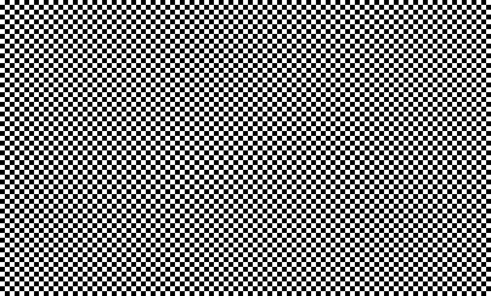
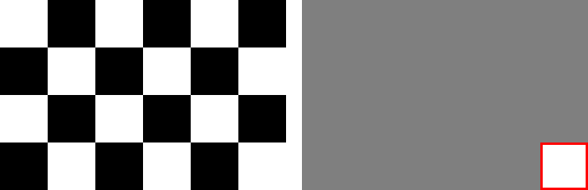
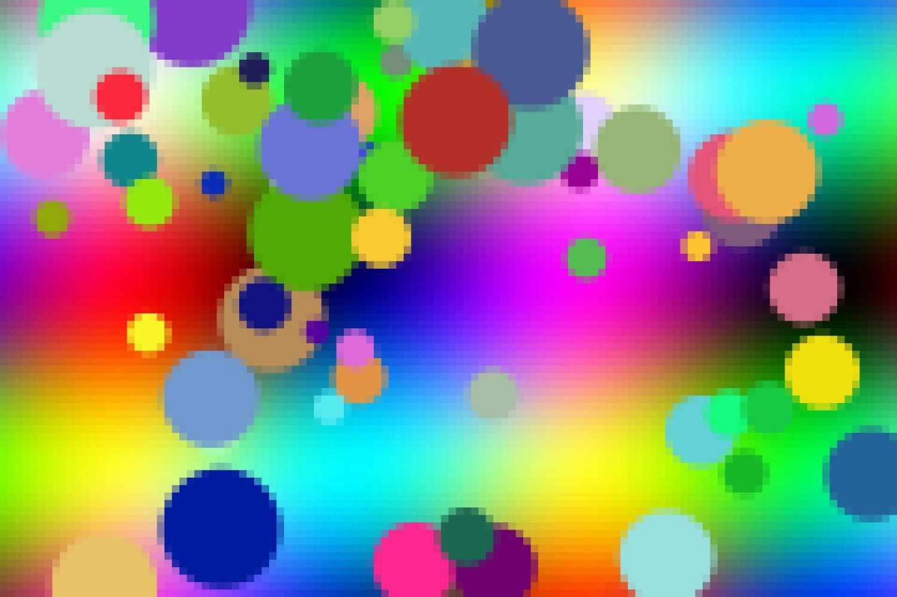

# Image averaging with threads

Kamran Pirishzada - CSCI 6221 Advanced Software Paradigms, Assignment 4

The program shows an image and replaces every square of the given size with its average color. The squares are processed one by one, so the progress is visible in the window. In mode `S` one thread does all the work, in mode `M` one thread per CPU core works on its own part of the image. The result is saved as `result.jpg`.

## How to run

Requirements: JDK 17 or newer (tested with OpenJDK 27 on macOS). No other libraries are needed.

The same commands work on macOS, Windows and Linux, from the repository folder:

```bash
javac -d out -sourcepath src src/Main.java
java -cp out Main samples/large.jpg 20 M
```

| Argument | Meaning |
|---|---|
| `samples/large.jpg` | the image file |
| `20` | square size in pixels |
| `M` | `S` = single-threaded, `M` = multi-threaded |

`result.jpg` is saved in the folder where the command is run. Closing the window stops the program.

For very large images, if Java reports `OutOfMemoryError`, give it more memory: `java -Xmx4g -cp out Main photo.jpg 20 M`.

## Design

| File | Responsibility |
|---|---|
| `Main.java` | Checks the input arguments, loads the image, opens the window, starts the processing and saves the final image |
| `ImageWindow.java` | Displays the image and makes it smaller on the screen if the original image is too big |
| `Processor.java` | Divides the image into squares and processes them using one or multiple threads |
| `SquareAverager.java` | Calculates the average color of each square |

- **Image and view.** I converted the image to `TYPE_INT_RGB`, so each pixel is stored as an integer in one array, and all threads work directly on this array. The window keeps its own small copy (the view), the size it shows on the screen. When a thread finishes a square, it also paints the average color into the matching area of the view. The window redraws only this small view every 30 ms, so it does not slow down the threads by redrawing the whole original image.
- **Original size.** If the image is larger than the screen, I only resize it for displaying in the window. The actual processing is still done on the original image, and `result.jpg` is also saved in its original size.
- **Squares.** I divided the image into squares and processed them from left to right, row by row. If the image size is not exactly divisible by the square size, the squares at the right and bottom edges are smaller.
- **Averaging.** For each square, I calculate the average red, green and blue values of its pixels. Then I use this average color for the whole square.
- **Visible progress.** At first, the processing was too fast, and it finished in just a few milliseconds. Because of this, I added a small pause after each square to make the progress visible. I adjusted the pause so that mode `S` takes around 10 seconds. For performance testing, I can disable this pause using `-DnoDelay=true`.

## Concurrency

- **Physical concurrency.** In mode `M`, I use `availableProcessors()` to get the number of available CPU processors. On my Mac, it returns 10, so I create 10 threads. This allows the work to run in parallel on multiple CPU cores.
- **Splitting.** I divided the image into horizontal parts, where each part contains complete rows of squares. Each thread gets one part and processes its squares from top to bottom and left to right.
- **Disjoint tasks.** Each thread works on a different part of the image, and no square is shared between threads. This means two worker threads never change the same pixel. Because of this, there is no race condition between the worker threads, so I don't need locks (competition synchronization) to protect the pixel data.
- **Cooperation synchronization.** I used `join()` to make the main thread wait until all worker threads finish their work. This is important because the final image should only be saved after all squares are processed. Without `join()`, the program could save an image that is not completely processed.
- **Why Java.** I chose Java because it supports parallel execution using threads and already has Swing for displaying images and ImageIO for reading and saving JPG files. I don't need any external libraries. In standard CPython, the GIL prevents multiple threads from executing Python code at the same time, so Python threads give only logical concurrency, not physical concurrency. That is why Java was a suitable choice for this experiment.

## Testing

### Checkerboard

I used a 1010 x 610 checkerboard with 10 px cells. With square size 20, most squares contain the same amount of black and white, so the result should be gray.

| Before | After (square size 20) |
|---|---|
|  |  |

**The white square in the bottom-right is correct.** The image size is not fully divisible by 20, so the last square is only 10 x 10 and contains one white cell. The other edge squares still contain both black and white, so they become gray.



This also shows that smaller squares at the edges are handled correctly.

### Large image

I also tested `large.jpg`, which is 6000 x 4000 and bigger than my screen. The program only scales it for the window, while the real image is still processed and saved at 6000 x 4000.

| Before | After (square size 50, I scaled it down for this README) |
|---|---|
|  |  |

### Same result in both modes

I processed `large.jpg` with square size 20 using both `S` and `M` modes. Then I compared the two result files with `cmp` and they were identical, so both modes produced the same output.

## Results

Apple M5, 10 cores, square size 5, delay disabled.

### First result

At first, multithreading was slower. On `large.jpg` (6000 x 4000), one thread took about 40 ms, while 10 threads took about 78 ms.

### Finding the problem

I measured the threads separately. Each of the 10 threads did only 1/10 of the work, but took 56-74 ms, longer than one thread doing everything (41 ms). So the threads were slowing each other down.

The problem was `System.nanoTime()`, which was called after every square (about 960,000 times) even when the delay was disabled. On macOS, Java keeps one shared value so that time never goes backwards between threads, and every call updates it. With many threads, they had to wait for each other there. This is competition synchronization hidden inside a library call. I changed the code so the clock is not used when there is no delay.

### After the fix

| | `large.jpg` (6000 x 4000) | 12000 x 8000 |
|---|---|---|
| S, 1 thread | 36-37 ms | 125 ms |
| M, 10 threads | 47-52 ms | 65-76 ms |

On the bigger image, multithreading was about 1.8 times faster.

For the smaller image, using many threads was not always better because creating and starting threads also has a cost. The best result there was around 2-4 threads.

I also tested with `-Xcomp`, and 10 threads took 31-38 ms instead of 47-52 ms, which shows that JIT warm-up was also part of the extra cost.

## Critique

- **Equal stripes are not always balanced.** I divided the image into equal horizontal parts for each thread. However, this does not mean that all threads finish at the same time, because some CPU cores may be slower than others. The total processing time depends on the slowest thread. One possible improvement would be to use a shared counter (`AtomicInteger`), where each thread takes the next available row of squares. This way, threads that finish earlier can continue processing other rows.
- **Artificial pause.** I added the pause only to make the processing visible in the window. With this pause, mode `M` looks around 10 times faster than mode `S`, but this happens mainly because multiple threads can sleep at the same time. So, this is not the real performance improvement. For the actual performance comparison, I disabled the pause and used the results from the previous section.
- **Window synchronization.** The window reads the view while the threads are still changing it, without synchronization, so sometimes one square can look unfinished for a moment. The next redraw fixes it, so I accepted this for a display. The saved image is correct because it is saved only after all threads finish (`join()`).
- **Simple averaging.** I calculated the average color directly from the RGB values of the pixels. However, this is not exactly how our eyes see mixed colors. A more accurate method would be to convert the RGB values to linear light before calculating the average.
- **Memory usage.** I keep the whole image in memory, using 4 bytes for each pixel. For example, an image with 100 million pixels would need around 400 MB just for the pixel data. Because of this, very large images may require more memory for Java. I could increase the available heap memory using `-Xmx`.